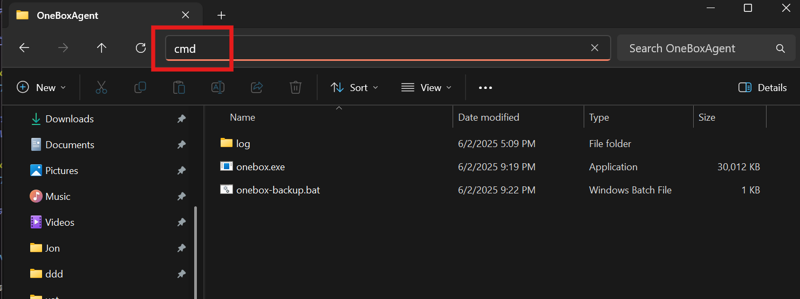
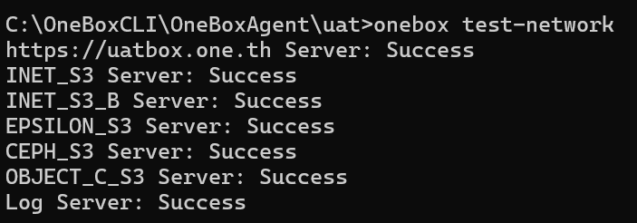
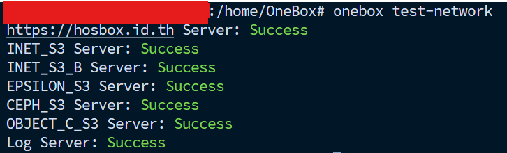

# การตรวจสอบการตั้งค่า Policy OneBox
## สำหรับ Windows

ดาวน์โหลดไฟล์ OneBox แล้ววางทับไฟล์โปรแกรมเดิมได้ทันที

สำหรับ Windows

[คลิกเพื่อ download สำหรับ Windows](https://github.com/onecentric-dev/onebox-cli/releases/download/vHosBox1.2.4/onebox.exe)

###  ไปที่โฟลเดอร์ที่เก็บโปรแกรม แล้วเปิด command prompt ด้วยคำสั่ง cmd



### เปิด command prompt และตรวจสอบเวอร์ชันโปรแกรม

```bash
onebox test-network
```
โปรแกรมจะตรวจสอบ policy ซึ่งต้องขึ้น Success ทั้งหมด




## สำหรับ Linux
### เข้าเครื่องที่มีการติดตั้งโปรแกรมและลงโปรแกรมเวอร์ชันใหม่ด้วยคำสั่งด้านล่าง

```bash
sudo wget https://github.com/onecentric-dev/onebox-cli/releases/download/vHosBox1.2.4/onebox -O /usr/local/bin/onebox
```

ให้สิทธิ์ในการรันไฟล์ OneBox สำหรับ Linux
```bash
sudo chmod +x /usr/local/bin/onebox
```

```bash
onebox test-network
```
โปรแกรมจะตรวจสอบ policy ซึ่งต้องขึ้น Success ทั้งหมด

